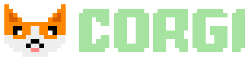
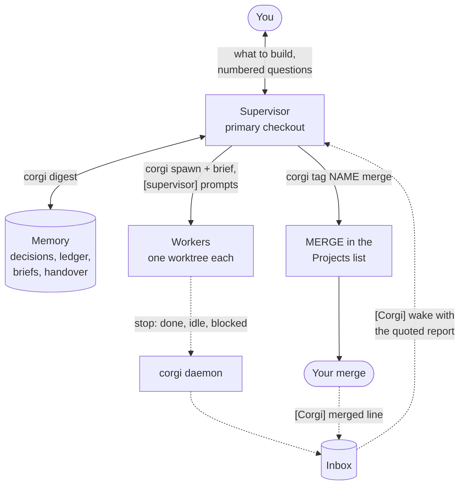

<p align="center">
  
</p>

<p align="center">
  <b>A supervisor for your coding agents, in the Herdr app.</b>
</p>

Corgi is a tool for the [Herdr](https://herdr.dev) app, which runs AI coding agents such as Claude Code and Codex in terminals. It gives each project one long-lived agent, the **supervisor**, that you talk to about *what* to build and *why*; it briefs worker agents, runs each in its own Git worktree, follows them, and tells you when their work is ready to merge.

- **A Projects list in the app's sidebar**: each repository with its supervisor and workers under it, their state (`WORKING`, `BLOCKED`, `DONE`, `IDLE`), how full each one's context is, and each plan's 5-hour and weekly usage.
- **A supervisor per project** that plans with you, dispatches workers, reviews their reports and keeps the project's decisions and history outside the repository.
- **Woken with the window closed**: `corgi daemon` runs as a service of your session, tells a supervisor when one of its workers stops, and hands it over to a fresh session before its context fills up.
- **Merge from the list**: a worker the supervisor tagged shows `MERGE`; a click merges its branch into the project's base branch and pushes it, then offers to close the worker and remove its worktree.

Install on macOS or Linux:

```bash
curl -fsSL https://raw.githubusercontent.com/zyrre/corgi/main/herdr-app/install.sh | sh
```

[Install](#install) has the requirements and the details.

## The supervisor

Each project can have one supervisor: a long-lived Claude Code or Codex session in the project's primary checkout. It turns what you ask for into briefs, runs worker agents in their own worktrees, reviews what they report, and keeps the project's decisions and history, so you deal with one agent instead of many. It never edits the checkout, merges or pushes itself. Its full role is [`supervisor/ROLE.md`](supervisor/ROLE.md).

- **Start it** with the `+` of the Projects list (type a project's name or path), or `corgi supervisor ~/repos/webshop` from a shell. It greets you with the open work, anything blocked or ready to merge, and the questions it still has for you.
- **Plans, then briefs**: it proposes how the work splits and which model and effort each part gets, waits for your go, then saves a self-contained brief per worker and starts each with `corgi spawn` in a fresh worktree. Spawn refuses a project outside Git or in Corgi's state directory, so a worker never lands in the wrong place.
- **Woken by its workers**: when a worker stops, the daemon puts a `[Corgi]` line in the supervisor's inbox, with the worker's report quoted when it is short, and types it in once the supervisor is between turns and its input box is empty. Nothing is lost while the daemon or the app is down, and nothing is typed in twice. `corgi inbox` shows what has not been typed in yet, and scripts add lines with `corgi notify`.
- **Questions you can answer at a glance**: anything that needs your judgement comes as a numbered question with options and a recommendation (`Q3: B` answers it), and a worker with an open question is not tagged for merge.
- **MERGE when it is ready**: once a worker's report meets its brief and its branch merges cleanly, the supervisor runs `corgi tag NAME merge` and the list shows `MERGE` in place of the worker's state. Your merge tells the supervisor, which records it and re-checks its other tagged workers against the moved base branch. A merge that stops on conflicts, or fails, can be handed to the supervisor from the card under the worker's row.
- **Memory that outlives its context**: a decision log, a ledger of every worker, and every brief, kept outside the repository. `corgi digest` gives it a bounded summary at the start of each session; `--search` finds older history, including the report of every worker it spawned, and `--show`, `--ledger` and `--brief` print what it finds in full.
- **Handover to a fresh session**: when its context is past 50% (on Claude Code, or 200k tokens) and it has idled nearly until its prompt cache expires, Corgi has it write a handover note and starts a fresh supervisor in the same terminal that picks up from it. With a smaller context, it also does this once the supervisor has idled that long and its context has doubled.
- **Lessons kept in the repo**: what a worker learned the hard way goes into `AGENTS.md` or `ARCHITECTURE.md` as a commit on that worker's branch, so the next worker knows it.
- **Cost-aware**: `corgi fleet` lists its agents with their context use and prompt cache, warm with the minutes left or cold with the tokens a follow-up would re-read, so it can start a fresh worker instead.
- **Out of your way**: agents you start or steer yourself are yours; it only notes significant decisions made there, silently.



## In the Herdr app

The install puts three mods into the app and the Projects list into your layout's sidebar ([`herdr-app/RECIPE.md`](herdr-app/RECIPE.md) describes them in full):

- **Projects**, in place of the sidebar's Spaces and Agents lists: each repository with its agents under it, and a `+` that opens a project by name or path and starts its supervisor. It also shows the projects of the other machines the window is connected to, and merges, closes and pauses there.
- **`⏸ Agents`**, beside the `+`, is for leaving the network: it stops the agents working right then (each ends its turn and exits, its conversation saved), holds every wake and handover while they are paused, and reads `▶ Agents` until you bring them back. Nothing is killed.
- **The last line** names the Corgi that answers (`Corgi 0.2.3 · 5b50895`), and says when its checkout has moved on or the daemon is down.

A layout of your own gets the list in place, and nothing else in it changes, so other mods' changes stay; Herdr's own `main` is first cloned to a layout called `corgi`, which the window switches to (`herdr-app do layout.switch '{"name":"main"}'` goes back).

## Commands

`corgi --help` lists them, and `corgi COMMAND --help` documents each.

| For | Commands |
| --- | --- |
| You | `corgi supervisor [PROJECT]` starts a project's supervisor; `corgi daemon install`, `status` and `uninstall` manage the service; `corgi notify` adds a line to a supervisor's inbox |
| A supervisor | `spawn`, `fleet`, `digest`, `report`, `inbox`, `tag`, `role` |
| The app's mods | `status`, `usage`, `projects`, `open`, `merge`, `close`, `pause`, `resume`, each with `--json` |
| The installer | `app-layout`, `daemon install` |

## Install

```bash
curl -fsSL https://raw.githubusercontent.com/zyrre/corgi/main/herdr-app/install.sh | sh
```

It installs the `corgi` command (linked into `~/.local/bin`), `corgi daemon` as a service of your session (a LaunchAgent on macOS, a systemd user unit on Linux), Corgi's mods and the Projects list in your layout's sidebar, and updates them when run again. With OpenCode installed, it asks once whether to add a small status plugin to `~/.config/opencode/plugin/`, without which an OpenCode worker wakes no supervisor. `herdr-app/install.sh --uninstall` puts Spaces and Agents back and removes the mods and the daemon.

Requirements:

- The [Herdr](https://herdr.dev) app (herdr-app 0.1.14 or newer) with herdr-core (`hc`)
- Git
- Claude Code, Codex or both, for the agents
- Rust 1.89 or newer, only when [building from source](#build-from-source)

The install downloads the prebuilt binary of its version, verified before execution against version and platform checksum pins committed in [`checksums/`](checksums/), or builds from source with `cargo build --release --locked` when a pin or matching download is unavailable. `CORGI_DOWNLOAD_URL=<url>` downloads from `<url>/v<version>/` instead of the GitHub release; mirrors must serve the same pinned bytes, and a remote `SHA256SUMS` never supplies trust.

## Build from source

```bash
git clone https://github.com/zyrre/corgi && cd corgi
CORGI_BUILD=source herdr-app/install.sh
```

Run from your own git checkout, the installer builds from source unless HEAD is exactly the release tag, so it never replaces your build with an older release; `CORGI_BUILD=source` always builds and `CORGI_BUILD=release` always downloads. Run it again after pulling: it rebuilds, restarts the daemon on the new binary and swaps in the mods that changed.

## Data and privacy

Corgi sends no telemetry. It keeps no terminal output or prompt history; what it stores, in `~/.local/state/corgi` (or `$XDG_STATE_HOME/corgi`), is its own bookkeeping and each supervisor's memory and inbox, which holds the reports of workers that stopped. The only network use is the plan usage: `codex app-server` for Codex, and Claude Code's stored login sent to `api.anthropic.com` for Claude. Corgi reads that login from `.credentials.json` in Claude Code's config directory (`$CLAUDE_CONFIG_DIR`, else `~/.claude`), or on macOS from the Keychain, which may ask you to allow it the first time. That Claude reading is unofficial and read-only, and may break if Anthropic changes the endpoint.

## More

- Architecture: [ARCHITECTURE.md](ARCHITECTURE.md) says how Corgi works on herdr-core, and why.
- Supervisor: [`supervisor/ROLE.md`](supervisor/ROLE.md) is the role every supervisor runs by, and [`supervisor/HANDOVER.md`](supervisor/HANDOVER.md) the part `corgi role handover` prints when it hands over.
- The mods: [`herdr-app/RECIPE.md`](herdr-app/RECIPE.md).

## Contributing

See [CONTRIBUTING.md](CONTRIBUTING.md).

## License

MIT, see [LICENSE](LICENSE).
