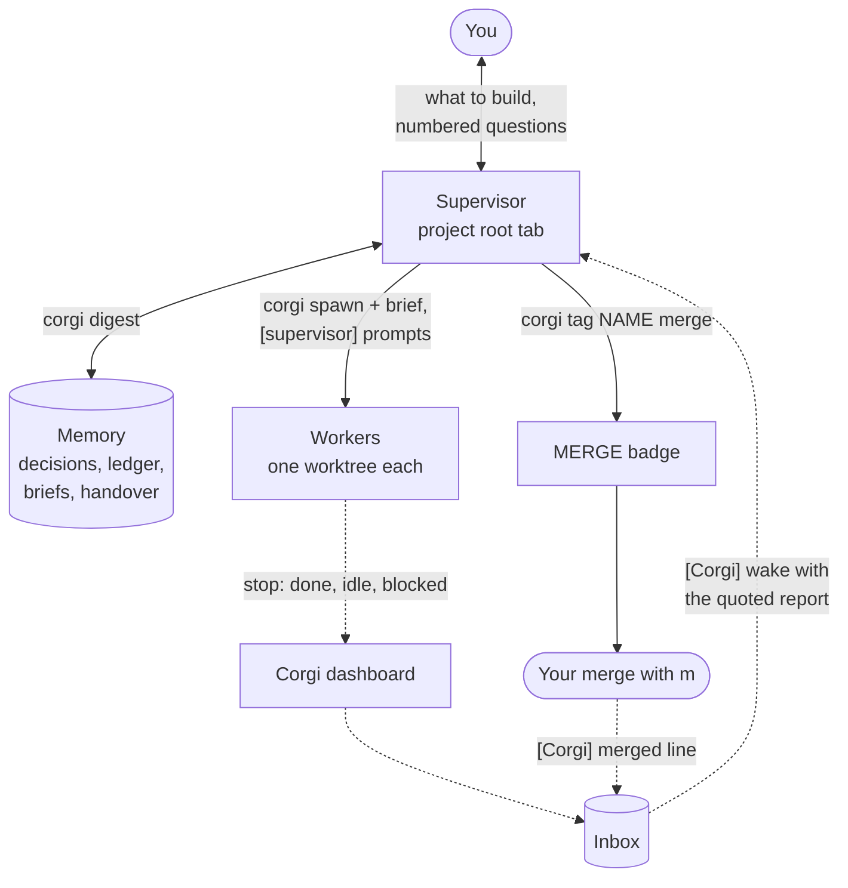
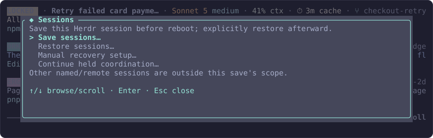

<p align="center">
  
</p>

<p align="center">
  <b>The dashboard for your Herdr agents, and a supervisor that runs them.</b>
</p>

Corgi is a plugin for [Herdr](https://herdr.dev), a terminal workspace manager for AI coding agents such as Claude Code and Codex.


- **One card per project with a supervisor**: the supervisor's latest message and command, and its workers summed up by state, with every blocked worker named. `→` expands a card into each worker's own rows, and Corgi remembers the choice per project.
- **One row per agent** of any kind Herdr can start, such as Codex and Claude Code, for expanded cards, projects without a supervisor, and scratch sessions.
- **What each agent is doing**: the newest thing said in its session and the command or tool it runs.
- **What it costs**: its model and effort, how full its context is, how long its prompt cache stays warm, and in the header, each CLI's 5-hour and weekly plan usage.
- **New agents in their own worktree** with `n`, and their work merged back with `m`, stamped with a check when it lands:


Install on macOS or Linux:

```bash
herdr plugin install zyrre/corgi && corgi setup
```

`corgi setup` binds a key that opens Corgi; [Install](#install) has the requirements and the details.

## The supervisor

Each project can have one supervisor: a long-lived Claude Code or Codex session in the project's root tab, which you talk to about *what* to build and *why*. It turns that into briefs, runs worker agents in their own worktrees, reviews what they report, and keeps the project's decisions and history, so you deal with one agent instead of many. It never edits the checkout, merges or pushes itself. Its full role is [`supervisor/ROLE.md`](supervisor/ROLE.md).

- **Start it** with `s` on any agent of the project, or `corgi supervisor ~/repos/webshop` from a shell. It greets you with the open work, anything blocked or ready to merge, and the questions it still has for you.
- **Plans, then briefs**: it proposes how the work splits and which model and effort each part gets, waits for your go, then saves a self-contained brief per worker and starts each with `corgi spawn` in a fresh worktree. Spawn refuses a project outside Git or in Corgi's state directory, so a worker never lands in the wrong place.
- **Woken by its workers**: when a worker stops, the dashboard puts a `[Corgi]` line in the supervisor's inbox, with the worker's report quoted when it is short, and types it in once the supervisor is between turns. Wakes survive the dashboard closing; `corgi inbox` shows what has not been typed in yet, and scripts add lines with `corgi notify`.
- **Questions you can answer at a glance**: anything that needs your judgement comes as a numbered question with options and a recommendation (`Q3: B` answers it), and a worker with an open question is not tagged for merge.
- **MERGE when it is ready**: once a worker's report meets its brief and its branch merges cleanly, the supervisor runs `corgi tag NAME merge` and the dashboard shows it with a magenta `MERGE` badge instead of `DONE`. Your `m` merge tells the supervisor, which records it and re-checks its other tagged workers against the moved base branch; a conflicted merge is handed to it from the merge popup.
- **Memory that outlives its context**: a decision log, a ledger of every worker, and every brief, kept outside the repository. `corgi digest` gives it a bounded summary at the start of each session, and `--search` and `--decision` find older history.
- **Handover to a fresh session**: when its context passes 50%, or it has idled nearly until its prompt cache expires, the dashboard has it write a handover note and starts a fresh supervisor that picks up from it.
- **Lessons kept in the repo**: what a worker learned the hard way goes into `AGENTS.md` or `ARCHITECTURE.md` as a commit on that worker's branch, so the next worker knows it.
- **Cost-aware**: `corgi fleet` lists its agents with their context use and prompt cache, warm with the minutes left or cold with the tokens a follow-up would re-read, so it can start a fresh worker instead.
- **Out of your way**: agents you start or steer yourself are yours; it only notes significant decisions made there, silently.



## Using the dashboard

### Keys

| Key | Action |
| --- | --- |
| `j` / `k`, `↑` / `↓` | Select an agent, or a collapsed project card as its supervisor |
| `→` / `←` | Expand the selected project's card into its workers' rows, or collapse it again |
| `space`, then `u` / `d`, `PgUp` / `PgDn` | Expand the selected session into its transcript and scroll it; `space` collapses it |
| `p` | Prompt the selected agent |
| `n` | Start a new agent in its own worktree |
| `t` | Start a scratch session in your home directory |
| `s` | Start or focus the supervisor of the selected agent's project |
| `S` | Save sessions, restore saved conversations, or continue held coordination |
| `m` | Merge and push an agent's worktree branch (asks first) |
| `f` or `Enter` | Focus the selected agent's pane |
| `e` | Open the selected agent's checkout in your editor, in a new tab of its workspace |
| `x` | Close the selected agent, and delete its worktree checkout (asks first) |
| `r` | Refresh now |
| `Esc`, `q` | Collapse the transcript, or close Corgi; `q` always closes |

For a compact popup instead of a tab, open the `quick` pane: `herdr plugin pane open --plugin io.github.zyrre.corgi --entrypoint quick`.

Corgi draws in your terminal's own colors, light or dark: the active theme of the [Omarchy](https://omarchy.org) Linux desktop, or else the palette your terminal (through Herdr) reports, with Catppuccin standing in when it reports none. Set `CORGI_THEME=catppuccin-mocha` or `catppuccin-latte` to force Catppuccin's own colors, or `CORGI_THEME=terminal` to ask the terminal even on an Omarchy machine (say, when you view it over SSH from another one).

### Review an agent's changes in your editor

`e` opens the selected agent's checkout in a new tab of that agent's workspace, named after its branch: the top of its Git work tree as it is on disk, uncommitted changes and all, so your editor's diff gutter shows what the agent changed (outside Git, its working directory). The tab's shell runs `$VISUAL`, else `$EDITOR`, else `vim`, as your shell config sets them, and is left in the checkout when you quit the editor.

The plugin's `edit` action does the same from anywhere in Herdr: for the agent in the focused pane, for the agent selected in Corgi when the dashboard is focused, and for a plain shell's directory. Herdr plugins cannot bind keys, so add one to `~/.config/herdr/config.toml` and run `herdr server reload-config`:

```toml
[[keys.command]]
key = "prefix+e"
type = "plugin_action"
command = "io.github.zyrre.corgi.edit"
description = "Corgi: edit agent checkout"
```

### Reading a row

In an expanded card, a project without a supervisor, and the scratch sessions, each agent has three rows:


### Read a session in place

`space` grows the selected row into the session's latest turns, newest first, without leaving the list.


### Start an agent


`n` opens the new-agent form with everything but the task preset: the selected agent's project, the default harness with its own model and effort, and a fresh worktree. Type the task and press `Enter`; `←` / `→` change a setting in place, and `Space` or typing opens its list. In a project with no agents yet, the first one is its supervisor. Each worker gets its own Git worktree on a fresh `worktree/<name>` branch; switch the Checkout row to work in the project directory as it is instead.

### Save and restore sessions

Press `S` before reboot to save supervisors, workers and scratch sessions. Save
records private recovery references while agents keep running; it lists missing
IDs, unsupported harnesses and interrupted work. Prepare **Manual recovery
setup** once before reboot: its explicit confirmation disables Herdr's automatic
agent resume while retaining layout restoration. Save reports when this setup
is still needed.



After reboot, choose **Restore sessions**, browse a dated snapshot and select
Codex or Claude Code conversations individually. Nothing is selected initially;
launching requires a separate confirmation with Cancel focused. Corgi resumes
inside the original Herdr-restored terminals, reuses matching running agents,
and offers a new placement only when the original is missing or occupied and
you explicitly select it. It sends no task. Restored supervisor coordination
stays held until you choose **Continue held coordination**.

Recovery needs the existing native conversation stores, repositories/worktrees
and supervisor memory. It preserves recoverable setup, not running tools,
unsent input or shell processes. Unknown settings and incomplete sessions stay
visible. See the [recovery contract and verification](docs/session-recovery-design.md)
for limits, retry behavior and the Claude documentation/fixture verification.

### Merging

`m` shows what the merge brings in, checks that both checkouts are clean, then runs `git merge --no-ff` and `git push` in the primary checkout, and offers to close the worktree. If the merge stops on conflicts, the popup lists the files; with a supervisor running, `s` aborts the merge and asks the supervisor to have the agent merge the base branch into its own branch and resolve them there, after which you merge again. Esc leaves the primary checkout mid-merge to resolve by hand.

## Install

Install on macOS or Linux:

```bash
herdr plugin install zyrre/corgi && corgi setup
```

Requirements:

- [Herdr](https://herdr.dev) 0.8.2 or newer
- Git
- Claude Code, Codex or both, for the agents
- Rust 1.89 or newer, only when [building from source](#build-from-source)

The install downloads the prebuilt binary of the plugin's version, verified before execution against version and platform checksum pins committed in [`checksums/`](checksums/), or builds local source with `cargo build --release --locked` when a pin or matching download is unavailable. It links the `corgi` command into `~/.local/bin` (if that is not on your `PATH`, run `~/.local/bin/corgi setup`). `corgi setup` asks which key should open the dashboard, or focus it when it is already open, `prefix+d` unless you type another; it appends that binding to Herdr's `config.toml`, reloads Herdr's config and opens Corgi, which confirms the key in a popup. It changes nothing when a key is bound already, and is safe to run again. Run the install again to update; `herdr plugin uninstall io.github.zyrre.corgi` removes it but leaves the link (`rm ~/.local/bin/corgi`).

To bind the key by hand instead, add this to `~/.config/herdr/config.toml` and run `herdr server reload-config`:

```toml
[[keys.command]]
key = "prefix+d"
type = "plugin_action"
command = "io.github.zyrre.corgi.open"
description = "Corgi (open or focus)"
```

## Data and privacy

Corgi talks only to the Herdr socket and sends no telemetry. It keeps no terminal output or prompt history; what it stores, in `~/.local/state/corgi` (or `$XDG_STATE_HOME/corgi`), is its own bookkeeping, private session recovery metadata and each supervisor's memory and inbox, which holds the reports of workers that stopped. The only network use is the plan usage: `codex app-server` for Codex, and Claude Code's stored login sent to `api.anthropic.com` for Claude. Corgi reads that login from `.credentials.json` in Claude Code's config directory (`$CLAUDE_CONFIG_DIR`, else `~/.claude`), or on macOS from the Keychain, which may ask you to allow it the first time. That Claude reading is unofficial and read-only, and may break if Anthropic changes the endpoint.

## More

- Architecture: [ARCHITECTURE.md](ARCHITECTURE.md) has the socket and API boundaries, and every behaviour in detail.
- Supervisor: [`supervisor/ROLE.md`](supervisor/ROLE.md) is the role every supervisor runs by, and `corgi <command> --help` documents each command.
- Omarchy companion: [`omarchy/`](omarchy/README.md) is a bar widget for the Omarchy desktop, with a compact dashboard of its own. Once Corgi is installed, `omarchy plugin add https://github.com/zyrre/omarchy-corgi.git --enable` adds it.

## Build from source

```bash
git clone https://github.com/zyrre/corgi && cd corgi
cargo build --release && herdr plugin link "$PWD"
```

Uninstall the plugin before you link, since both use the same id. The installer builds from source when `CORGI_BUILD=source` is set, and `CORGI_DOWNLOAD_URL=<url>` downloads from `<url>/v<version>/` instead of the GitHub release; mirrors must serve the same pinned bytes. Remote `SHA256SUMS` never supplies trust. `CORGI_LINK=0` skips the `~/.local/bin` link, and `CORGI_BIN_DIR=<dir>` links into `<dir>` instead.

## Contributing

See [CONTRIBUTING.md](CONTRIBUTING.md).

## License

MIT, see [LICENSE](LICENSE).
