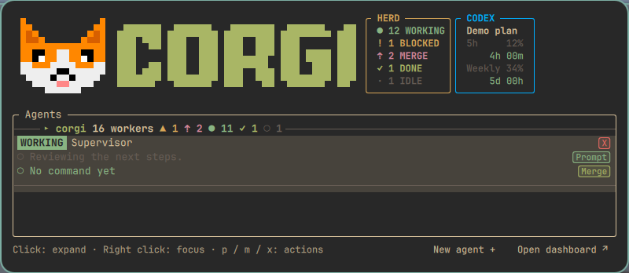

# Corgi for the Omarchy bar

A bar widget for the [Omarchy](https://omarchy.org) desktop that shows the
coding agents running in [Herdr](https://herdr.dev), the way the
[Corgi](https://github.com/zyrre/corgi) dashboard does. A corgi in the bar
opens a compact popup with each agent's project, state, model and context
use, prompt cache, latest message and command, and your plan usage. From the
popup you can prompt, merge or close an agent, start a new one, and jump to
its pane in the terminal. Colors follow the active Omarchy theme.



The preview uses made-up agents and illustrative usage data. The HERD card shares
the dashboard’s WORKING, BLOCKED, MERGE, DONE and IDLE counts; agents tagged
ready to merge count as MERGE instead of DONE or IDLE.

The bar shows the corgi with a small underline when agents are running
(accent), need your attention (urgent) or have finished (green); attention
wins, and idle agents leave no underline. Hover for the agent counts.

## What you need

- Omarchy with its Quickshell-based shell, where `omarchy plugin` is
  available. Jumping to a pane uses Hyprland's `hyprctl`, which Omarchy has.
- Herdr 0.8.2 or newer, with the `herdr` command on your `PATH`.
- Corgi, installed as a Herdr plugin. Its install links the `corgi` command
  into `~/.local/bin`, which is on the Omarchy session's `PATH`; the widget
  runs that command and has no program of its own.

The widget's version matches the Corgi release it was published with. Keep
them together: a widget newer than your Corgi may ask it for things it cannot
do yet.

## Install

```sh
herdr plugin install zyrre/corgi
omarchy plugin add https://github.com/zyrre/omarchy-corgi.git --enable
```

The corgi appears in the center of the bar, ready for the default Herdr
session with no settings.

## Update

```sh
herdr plugin install zyrre/corgi
omarchy plugin update io.github.zyrre.corgi
```

Running Herdr's install again updates Corgi.

## Remove

```sh
omarchy plugin remove io.github.zyrre.corgi
```

This removes only the widget. To remove Corgi as well, run
`herdr plugin uninstall io.github.zyrre.corgi` and `rm ~/.local/bin/corgi`.

## Settings

All are optional. Change them in the widget's settings in the Omarchy bar.

| Setting | Default | What it does |
| --- | --- | --- |
| Refresh interval (seconds) | 5 | How often the widget rereads an expanded transcript, and restarts its reader if it stopped. |
| Bar display | Icon | `Icon` shows the corgi; `Compact` adds the agent counts beside it. |
| Corgi command | `corgi` | The Corgi command to run. Set a full path only to use another build. |
| Herdr socket | empty | Only for a named Herdr session (`herdr --session <name>`): that session's socket. Empty means the default session, `~/.config/herdr/herdr.sock`. |

## Using the popup

- Left click the corgi to open or close the popup; right click it to
  reconnect when the reader stopped.
- Projects led by a supervisor start collapsed, showing the supervisor and a
  count of workers by state, with a closing rule beneath the supervisor.
  The summary uses colored dashboard icons for blocked, merge-ready, working,
  done and idle workers. Only the total has a visible label; state segments
  show an icon and count, with state names in tooltips. They wrap on narrow
  popups. Click that row or its ▸ project heading to reveal
  the agents; click the ▾ heading to collapse them. Scratch sessions and projects
  without a supervisor always show their agents.
- Each visible agent takes three lines: its state and task with model, context,
  cache and checkout; its latest message; and its current or latest command.
- Click an exposed agent, or press Space or Enter, to expand its newest-first
  transcript. Up/Down selects an agent; Right reveals its project or transcript.
  Right click an agent to jump to its pane: Herdr shows the pane, and the
  terminal window attached to the session comes into view.
- **Prompt** (or `p`) sends the agent a prompt: Enter sends, Shift+Enter adds
  a line, Escape cancels. A blocked agent needs an answer in its own pane.
- **Merge** (or `m`) reviews the agent's commits, merges and pushes them from
  the main checkout, and offers to close the worktree.
- **X** (or `x`) closes the agent, with the dashboard's confirmation and its
  protection for unsaved work in the worktree.
- **New agent +** (or `n`) opens a form for project, harness, model and
  worktree; the popup closes once the agent has taken its first prompt.
- **Open dashboard** (or a click on the Corgi logo) opens the full Corgi
  dashboard in Herdr, or brings it into view when it is already open.
- Escape, Left or Backspace leaves the transcript, then collapses the selected
  project, then closes the popup. Clicking outside closes it. Projects start
  collapsed again the next time you open the popup.

## When something is wrong

- **"Corgi reader stopped"**: the shell cannot run `corgi`. Check that
  `~/.local/bin/corgi` exists, or set **Corgi command** to its full path.
- **"Herdr unavailable"**: Herdr is not running, or it runs a named session;
  set **Herdr socket** to that session's socket.
- **"no attached terminal window was found"**: Herdr showed the pane, but no
  terminal window has a Herdr client attached to that session. Open one with
  `herdr` (or `herdr --session <name>`).

## What it runs

The widget runs `corgi` (which talks to Herdr's socket, and fetches plan
usage as described in Corgi's README), `herdr agent prompt` to send prompts,
and, when you jump to a pane, `herdr status` and `hyprctl` to find and focus
the terminal. It reads `/proc` to tell which terminal shows the session. It
installs nothing and keeps no data of its own.

## Source and license

This widget is developed in the `omarchy/` folder of
[zyrre/corgi](https://github.com/zyrre/corgi) and published here with each
Corgi release; report issues and send changes there. MIT licensed; see
`LICENSE`.
